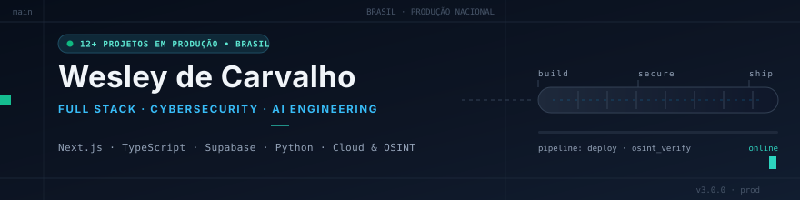



  

  

  
  &nbsp;
  
  &nbsp;
  
  &nbsp;
  
  &nbsp;
  

---

## 🔔 What's Happening Now

> Atualizações recentes do ecossistema em produção.

| Frente | O que está no ar e em evolução |
|:---:|:---|
| 🛡️ | **Lançado:** [**CyberSecurity Enterprise**](https://cyber-security.fincontrolx.com.br/) — plataforma de Segurança da Informação & Continuidade B2B com **Scanner OSINT via Cloudflare DoH (`SPF` · `DMARC` · `MX` · `DNSSEC`)**, Checklist Industrial, Simulador Financeiro, Governança LGPD (Lei 13.709/2018) e Relatório A4 em 1 página para Diretoria |
| 💰 | **SaaS & FinTech:** evolução contínua do [**FinControlX**](https://fincontrolx.com.br) com Next.js, TypeScript, Supabase, TanStack Query, Zustand, Recharts, Sentry e PostHog |
| 🧠 | **IA & Creative OS:** expansão do [**Suporte Ajuda**](https://suporteajuda.fincontrolx.com.br/) integrado a motores locais (**PhotoCraft PSD**, **FilmCraft / Viral Cuts 9:16**, **Whisper GPU**, **Radar CNPJ & LeadFinder B2B**) |
| 🖨️ | **WebGL & 3D:** [**PrintForge 3D**](https://print3d.fincontrolx.com.br) com visualização `Three.js`, remoção de fundo com IA e pipeline `Express + Gradio` |
| 🌎 | **Atuação Nacional:** arquitetura digital, automação e cibersegurança atendendo empresas, indústrias e operações digitais em **todo o Brasil** |

---

## 🚀 Sobre Mim

Desenvolvedor **Full Stack**, consultor de **Segurança da Informação (CNAE 6204-0/00)** e arquiteto de **automações com Inteligência Artificial**. Construo produtos digitais completos — do frontend de alta conversão ao backend seguro, passando por bancos relacionais, observabilidade, SEO técnico e blindagem de infraestrutura.

- 🇧🇷 Atendimento e entregas para empresas e projetos em **todo o Brasil**
- 🛡️ Especialista em **Continuidade Operacional B2B, OSINT Passivo, Blindagem de E-mail (SPF/DMARC) & LGPD**
- ⚡ Stack principal: **Next.js · React · TypeScript · Supabase · Python · Tailwind CSS · Vercel**
- 🤖 Engenharia aplicada em produção: **Computer Vision (TensorFlow.js / Face API), Whisper GPU, Three.js, Playwright & LLMs**

---

## 🌐 Ecossistema em Produção (12 Plataformas no Ar)

### 🛡️ Cibersegurança, SaaS, IA & 3D

| Projeto | Descrição & Diferenciais Técnicos | Stack | Acesso |
|:---:|:---|:---:|:---:|
| 🛡️ **CyberSecurity** | Segurança B2B & Continuidade Operacional: Scanner OSINT em 4 etapas (`SPF/DMARC/MX/DNSSEC` via Cloudflare DoH), Checklist Industrial, Simulador Financeiro, Relatório A4 (`@media print`) e Governança LGPD | `HTML5 · CSS3 · JS · Cloudflare DoH · Schema.org` | [Acessar](https://cyber-security.fincontrolx.com.br/) |
| 💰 **FinControlX** | Plataforma SaaS de inteligência e controle financeiro com internacionalização, gráficos executivos e telemetria | `Next.js · TypeScript · Supabase · Recharts · Sentry · PostHog` | [Acessar](https://fincontrolx.com.br) |
| 🎧 **Suporte Ajuda** | Central de atendimento inteligente integrada ao ecossistema de produção criativa e inteligência comercial B2B | `React · Prisma · Supabase · Zustand · Zod` | [Acessar](https://suporteajuda.fincontrolx.com.br) |
| 📣 **Viral Cuts Pro** | Automação de cortes verticais `9:16`, legendagem/transcrição GPU e distribuição multicanal | `Whisper GPU · FFmpeg · Node.js · Python` | [Web](https://viral.fincontrolx.com.br) · [Releases](https://github.com/PAGUESEGURO/Viral-Cuts-Pro-Releases) |
| 🖨️ **PrintForge 3D** | Plataforma de manufatura e impressão 3D com viewport interativo, remoção automática de fundo e API de IA | `React · Vite · Three.js · Express · Gradio` | [Acessar](https://print3d.fincontrolx.com.br) |

### 💼 Verticais, Educação, Viagens, Fitness & E-Commerce

| Projeto | Descrição & Diferenciais Técnicos | Stack | Acesso |
|:---:|:---|:---:|:---:|
| 🏋️ **Zakan Fit** | Plataforma fitness com análise computacional em browser, rate-limit distribuído e observabilidade | `Next.js 15 · React 19 · Supabase · TensorFlow.js · Upstash Redis` | [Acessar](https://zakanfit.fincontrolx.com.br) |
| 💼 **Estágio Pro** | Ecossistema de carreira, vagas, conteúdo editorial e fluxo transacional automatizado | `Next.js · Supabase SSR · Framer Motion · Resend · Zod` | [Acessar](https://estagiopro.fincontrolx.com.br) |
| ✈️ **Passagens Baratas** | Buscador e comparador inteligente de passagens aéreas com revalidação rápida em cache | `Next.js · SWR · Zod · APIs de Voos` | [Acessar](https://passagens.fincontrolx.com.br) |
| 🎓 **Teacher Letícia Pro** | Portal educacional com artigos `MDX`, área do aluno e pagamentos integrados | `Next.js · MDX · Supabase · Mercado Pago · Resend` | [Acessar](https://teacherleticia.fincontrolx.com.br) |
| 🍫 **Chocolamor** | E-commerce de chocolates artesanais com vitrine rápida, testes automatizados e painel administrativo | `React · Vite · TypeScript · shadcn/ui · Supabase · Vitest · Playwright` | [Acessar](https://chocolamor.fincontrolx.com.br) |
| 👜 **Lidiane Miranda** | Presença digital institucional focada em marca e conversão de clientes | `HTML5 · CSS3 · JS · Supabase · Vercel` | [Acessar](https://www.lidianemiranda.com.br) |
| ⚡ **RANKUPOFICIAL** | Loja e ecossistema oficial integrado a infraestrutura de jogos e alta concorrência | `Next.js · Supabase · Velocity Proxy` | [Acessar](https://loja.fincontrolx.com.br/) |

---

## ⚙️ Motores Internos, IA & Infraestrutura (`Desktop\Projetos`)

Além das aplicações web em produção, mantenho motores e pipelines locais voltados para produtividade, prospecção e automação:

| Motor / Pipeline | O que resolve | Tecnologias |
|:---:|:---|:---|
| 🎬 **VideoTradutor** | Pipeline local em Python para transcrição, tradução de vídeo e síntese de áudio automatizada | `Python · Whisper · Áudio/NLP` |
| 🤖 **Agentes de Automação (`facil` / `Gringo`)** | Automação de fluxos web, geração multimodal, dashboards operacionais e automação assistida por voz | `Node.js · Python · Gemini · Groq · Playwright` |
| 🧩 **Inteligência Comercial & Mídia** | Suite integrada do ecossistema FinControlX para prospecção B2B (`Radar CNPJ`, `LeadFinder`) e produção criativa (`PhotoCraft PSD`, `FilmCraft`) | `Node Bridge · Prisma · Whisper GPU` |
| 🛡️ **Redes & Infraestrutura (`Velocity` / `Genesis`)** | Proxies escaláveis em Java (`Velocity 4.x`) e validadores automatizados de workflows internos | `Java · TOML · Python` |

---

## 🛠️ Stack Tecnológico Real

**Frontend, 3D & Design System**

**Backend, Banco de Dados, Auth & Pagamentos**

**Cibersegurança, IA, Testes & Cloud**

---

## 📊 Atividade & Estatísticas no GitHub

  
  &nbsp;
  

  

---

## 💼 Vamos Construir ou Proteger o Seu Projeto?

Atendimento direto para **software sob medida, plataformas SaaS, automações com IA e blindagem de Segurança da Informação (LGPD / ERP / Domínios Corporativos)** em **todo o Brasil**.

 

&nbsp;&nbsp;

&nbsp;&nbsp;

&nbsp;&nbsp;

---

Desenvolvido por <strong>Wesley de Carvalho</strong> · Brasil · <a href="mailto:wesleyccs24@gmail.com">wesleyccs24@gmail.com</a>

